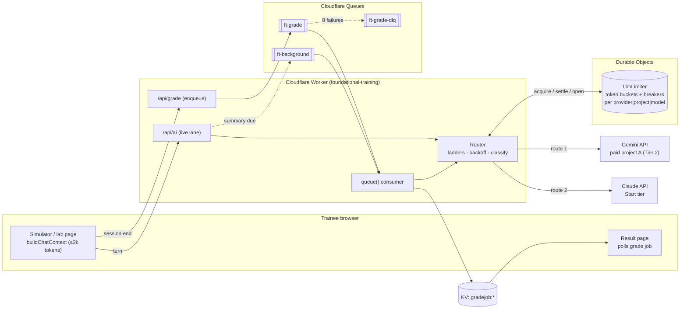

# AI Capacity Plan: no mid-session token exhaustion for live cohorts

**Scope:** every AI call the LSH training stack makes during a live cohort of ~20 trainees. That covers the call and chat simulators, the practice labs, the CMS activity evaluations, the transcript auto-grading and the trainer tools.
**Goal:** a cohort never sees a 429, an "AI is busy" message, or a stalled simulator, at any hour of the training day.
**Status:** this is the plan only. No code changes ship with this document. Each phase in §8 is a separate, small PR.

---

## 0. Summary

| # | Change | Fixes | Effort |
|---|---|---|---|
| 1 | **Move off the free tier.** Use one billing-linked Gemini project at Tier 2, plus a Claude API org as the second vendor. | Daily quota exhaustion (RPD), the main cause of afternoon outages | Config + ~$100 prepay |
| 2 | **Stop retry amplification.** A chat turn can turn into dozens of upstream calls (see §1.2). | 429 storms that feed on themselves | Small |
| 3 | **Cap the simulator context.** Use a frozen system prompt, a rolling summary and the last 8 messages, with a hard 3,000-token input cap. | Context snowballing, TPM spikes late in a session | Small–medium |
| 4 | **Use one shared limiter.** A Durable Object token bucket per provider and model, with separate lanes for chat and grading. | Isolates that can't see each other's limits; grading bursts starving chat | Medium |
| 5 | **Queue the grading.** Cloudflare Queues sends grading through the batch lane, never the live lane. | End-of-session grading spikes colliding with live simulators | Medium |
| 6 | **Router with circuit breakers.** Exponential backoff with full jitter, and a per-workload model ladder that crosses vendors. | Single-provider outages and per-model quota walls | Medium |

Steps 1–3 remove most of today's 429s. Steps 4–6 make the system hold up under load spikes and provider incidents.

---

## 1. Where the 429s come from today

### 1.1 How the stack makes AI calls today (from the code)

| Fact | Where |
|---|---|
| Every AI feature goes through `POST /api/claude` (alias `/api/ai`) to `callGemini()`. | `worker.js` |
| The keys are a pool of **free-tier** Gemini keys: `GEMINI_API_KEY5…9`, with `GEMINI_API_KEY`, `GEMINI_API_KEY1` and `GEMINI_API_KEY2` as spares. | `worker.js` (`GEMINI_POOL`) |
| Model ladder: chat starts on `gemini-3.5-flash-lite`; grading and trainer tools start on Flash (`gemini-3.8-flash` → `3.6` → `3.5`), then fall back to Flash-Lite. | `geminiModels()` |
| **A key's "resting" state lives in an in-memory `Map` inside each Worker isolate.** A key one isolate just saw hit its limit is still "fresh" to every other isolate. | `geminiRest` |
| The client retries 429/5xx up to 3 more times (2.5 s, 6 s and 12 s, with jitter). | `index.html` → `callAIText` |
| Each simulator turn sends the **full client dossier (≈5,700 chars ≈ 1,400 tokens) plus the entire transcript so far** as a single user message, with no system prompt and no window. | `index.html` → `rpSendMessage` and the other sims |
| Chat asks for `max_tokens: 200`, but the Worker sends `maxOutputTokens = max(2×200, 2048)` with `thinkingLevel: "low"`, so thinking tokens are spent on every chat line. | `callGemini()` |
| An optional shared gateway exists: the Main Portal's `/api/ai-gateway`, used when `AI_GATEWAY_SECRET` is set. | `viaGateway()` |

### 1.2 Failure mechanics

1. **Daily quota (RPD) is the hard wall.** Free-tier limits are per Google Cloud project, not per key. Flash has a small daily allowance, and Flash-Lite a few hundred to about a thousand requests per project per day. A cohort of 20 uses the whole pool by early afternoon (see §1.3). After that, every model in the ladder returns 429 until midnight Pacific time.
2. **Retry amplification.** A single chat turn that meets a busy pool can, in the worst case, trigger:
   - the client sending the request 4 times (1 + 3 retries);
   - the Worker trying up to 8 keys × 4 models per request.

   That's up to about 128 upstream calls for one simulator line. The per-isolate rest map only partly limits this, because each new isolate tries again from scratch. On a hot afternoon this turns a short rate-limit blip into a sustained storm.
3. **Context snowball.** Input per turn grows by about 60–80 tokens per message. A 40-message roleplay sends about 4,500 tokens on its last turn, against about 1,600 on its first. The TPM need climbs during the session, so limits trip near the end of a session, when trainees are most invested.
4. **Grading collides with chat.** Trainees finish a simulator together, so about 20 grading calls of roughly 8,000 tokens each arrive in the same minute. They land on the same keys and minutes as the live chat traffic of everyone still in a call.

### 1.3 Demand model (20 concurrent trainees)

Assumptions, calibrated from the code paths above:
- **Chat:** at peak a trainee sends one line every 15 s, which is 4 RPM per trainee.
- **Grading:** one evaluation per finished session.
- **Day total:** about 6 simulator sessions per trainee per day, at about 15 turns each.

| Workload | Peak RPM | Input tokens / request | Peak input TPM | Requests / day |
|---|---|---|---|---|
| Chat, today (no window) | 80 | 1,600 → 4,500 (grows) | ~280,000 | ~1,800 |
| Chat, with the window in §2 | 80 | ≤ 3,000 (flat; ~1,600 of it cacheable) | ≤ 240,000 (≤ 110,000 uncached) | ~1,800 |
| Rolling summaries (§2) | ≤ 15 | ~1,400 | ~20,000 | ~300 |
| Grading and evaluations | 20 (burst) | ~8,000–14,000 | ~200,000 (burst) | ~200 |
| Trainer tools, tracker review | < 5 | 1,000–3,000 | < 15,000 | < 100 |
| **Total (with the window)** | **~120** | | **~475,000 burst** | **~2,400** |

**Design target, with 2× headroom:** 250 RPM, 1,000,000 input TPM, 150,000 output TPM and 5,000 requests a day. The live lane never waits more than 1.5 s for capacity.

---

## 2. Context optimization and window management

### 2.1 Token budget per simulator request

| Segment | Content | Budget (tokens) | Cache |
|---|---|---|---|
| **S: frozen system prompt** | Persona rules, scenario card, client dossier, output rules. Byte-identical for the whole session, and always sent first. | ≤ 1,600 | Yes: Claude `cache_control`, Gemini implicit prefix caching |
| **M: rolling memory** | A third-person summary of everything before the window: facts disclosed, commitments made, caller mood and its trend, open issues. | ≤ 200 | No |
| **W: verbatim window** | The last 8 messages, with each message clipped to 120 tokens. | ≤ 1,000 | No |
| **U: the new trainee message** | Clipped to 250 tokens. | ≤ 250 | No |
| **Hard input cap** | S + M + W + U | **≤ 3,000** | |
| **Output** | 1–3 sentences in character | `max_tokens` 160 (Claude) / `maxOutputTokens` 256, thinking minimal (Gemini) | |
| **Session cap** | After 40 messages the caller wraps up the call (scripted close), and the session goes to grading. | 40 messages | |

These are the rules for the window:
- **Pruning order when over the cap:**
  1. Drop the oldest window message, down to a floor of 4 messages.
  2. Truncate M to 120 tokens.
  3. Clip U.
  4. S is never truncated. It has to fit its budget by construction, which a build-time check enforces.
- **Token estimate:** ceil(chars / 3.5) is a conservative estimate for English. Claude Haiku 5.5's tokenizer counts about 30% more tokens than older Haiku, and the 3.5-chars rule already covers that. Re-baseline with `count_tokens` once.

These are the rules for the summary:
- **When it runs:** a summary is due when 6 or more messages have aged out of the window since the last summary, or when W exceeds 1,000 tokens.
- **How it runs:** the summary runs in the **background lane** (§3) and is never on the live path. It is computed after the reply is sent, from the old M plus the messages that aged out.
- **If it fails:** keep the old M and let the hard cap prune. A missed summary costs some memory, never an error.

### 2.2 Grading budgets (never summarized)

Grading must see the real transcript, because fairness and evidence quoting depend on it.

| Segment | Budget |
|---|---|
| Rubric + grading rules (frozen) | ≤ 1,500 tokens (cached) |
| Transcript | ≤ 12,000 tokens verbatim |
| Session metadata | ≤ 300 tokens |
| Output (strict JSON) | `max_tokens` 1,200 |
| Transcript > 12,000 tokens | Map-reduce: split into chunks of 6,000 tokens, have each chunk extract evidence per criterion (≤ 400 tokens), then make one reduce call that scores the criteria from that evidence |

### 2.3 Code: rolling window and pruning (browser or Worker)

```js
// Context builder for a simulator turn: frozen system prompt + rolling memory + last N messages, hard-capped.
const BUDGET = { system: 1600, memory: 200, window: 1000, msgClip: 120, user: 250, hardCap: 3000, minWindow: 4, windowMsgs: 8 };
const tok = (s) => Math.ceil(String(s || "").length / 3.5);                 // conservative estimate
const clip = (s, maxTok) => { const max = maxTok * 3.5 | 0; s = String(s || ""); return s.length <= max ? s : s.slice(0, max - 1) + "…"; };

/**
 * session = { system, memory, history: [{role:"user"|"assistant", text}], summarizedUpTo }
 * returns { system, messages, needsSummary }
 */
function buildChatContext(session, userText) {
  if (tok(session.system) > BUDGET.system) throw new Error("system prompt over budget: fix it at build time");
  const user = clip(userText, BUDGET.user);
  let windowMsgs = session.history.slice(-BUDGET.windowMsgs).map((m) => ({ role: m.role, text: clip(m.text, BUDGET.msgClip) }));
  let memory = clip(session.memory || "", BUDGET.memory);

  const total = () => tok(session.system) + tok(memory) + windowMsgs.reduce((n, m) => n + tok(m.text), 0) + tok(user);
  while (total() > BUDGET.hardCap && windowMsgs.length > BUDGET.minWindow) windowMsgs.shift(); // 1. oldest first
  if (total() > BUDGET.hardCap) memory = clip(memory, 120);                                     // 2. shrink memory

  // Messages that aged out of the window and aren't in the memory yet.
  const agedOut = session.history.length - BUDGET.windowMsgs - (session.summarizedUpTo || 0);
  const windowTok = windowMsgs.reduce((n, m) => n + tok(m.text), 0);

  const messages = [];
  if (memory) messages.push({ role: "user", text: `[Earlier in this call]\n${memory}` }, { role: "assistant", text: "(continuing the call)" });
  for (const m of windowMsgs) messages.push(m);
  messages.push({ role: "user", text: user });
  return { system: session.system, messages: mergeSameRole(messages), needsSummary: agedOut >= 6 || windowTok > BUDGET.window };
}

// Both providers want alternating roles: merge consecutive messages from the same speaker.
function mergeSameRole(list) {
  return list.reduce((out, m) => {
    const last = out[out.length - 1];
    if (last && last.role === m.role) last.text += "\n" + m.text; else out.push({ ...m });
    return out;
  }, []);
}

// Background summary prompt (background lane, max_tokens 220; on failure keep the old memory).
const SUMMARY_PROMPT = (memory, agedOut) => `Update the running notes of this training call.
Keep: facts the caller disclosed, what the trainee promised, the caller's mood and its trend, open issues.
Max 150 words, third person, no quotes.
PREVIOUS NOTES:\n${memory || "(none)"}\nNEW MESSAGES:\n${agedOut.map((m) => `${m.role === "user" ? "TRAINEE" : "CALLER"}: ${m.text}`).join("\n")}`;
```

The rules for the system prompt:
- **What it contains:** the dossier, the persona and the scenario move into `system`. Today they're inside the user message.
- **No per-turn values in it:** no timestamps and no "turn 7 of …" counters, so the cache prefix stays byte-stable.
- **Build-time check:** a check in `.github/scripts/` fails the build if any scenario's frozen system prompt is over 1,600 tokens.

---

## 3. Asynchronous job queuing and rate smoothing

### 3.1 Platform mapping (we're on Cloudflare Workers, not a Node server)

The brief names Redis + BullMQ or Celery. The Cloudflare equivalents keep us on the platform we already deploy to, with no new servers:

| Need | Redis / BullMQ | Cloudflare (recommended) |
|---|---|---|
| Durable job queue with retries, delay and dead-letter | BullMQ queue | **Cloudflare Queues** (producer binding + `queue()` consumer, `max_retries`, `retry_delay`, dead-letter queue) |
| Globally consistent counters / token buckets | Redis `INCR` + Lua | **Durable Object** (single-threaded, strongly consistent, ~ms latency) |
| Job results / status | Redis hash | **KV** (`gradejob:<id>`), as the Worker already does for records |
| Scheduled sweeps | BullMQ repeatable jobs | Cron trigger (already in `wrangler.json`) |

The same design ports directly to Redis + BullMQ:
- each lane becomes a BullMQ queue;
- the limiter becomes a Lua token bucket;
- the circuit-breaker state lives in Redis.

### 3.2 Lanes

| Lane | Traffic | Path | Capacity share | Wait budget |
|---|---|---|---|---|
| **live** | Simulator and chat turns, interactive lab hints | Synchronous request → Router | Reserved **60%** of each bucket; can use 100% when the other lanes are idle | ≤ 1.5 s for a token, then fail over to the next route |
| **grade** | Transcript grading, CMS activity evaluations, Process-Question scoring | Queue → consumer → Router | ≤ **35%**, borrows idle capacity | Minutes; the trainee sees "Grading… (usually under 1 min)" |
| **background** | Rolling summaries, tracker notes review, nightly checks | Queue (lowest priority) → Router | ≤ **5%**, borrows idle capacity | Best effort; skipped if it isn't done within 2 min |

### 3.3 Rate limiter: a token bucket per (provider, project, model), in one Durable Object

Why a token bucket:
- **It matches the providers.** The Claude API documents a token-bucket algorithm (continuous replenishment), and Gemini enforces per-minute windows.
- **It shapes traffic smoothly.** Requests flow continuously instead of bursting at the start of each minute.
- **It supports reservations.** Lane shares are implemented as reserved capacity inside one bucket.

How the buckets are set:
- **Each bucket refills at 80% of the provider's published limit.** The other 20% covers estimation error and traffic that bypasses the limiter.
- **The live lane can always draw.** The other lanes can draw only while the bucket stays above the live reserve.

```js
// LlmLimiter Durable Object: one instance per provider+project+model (idFromName("gemini|projA|gemini-3.5-flash-lite")).
// Strongly consistent across every Worker isolate, unlike today's per-isolate geminiRest Map.
export class LlmLimiter {
  constructor(state, env) { this.state = state; this.b = null; }
  async load() {
    if (this.b) return;
    this.b = (await this.state.storage.get("b")) || null;
  }
  // cfg = { rpm, tpm, safety: 0.8, liveReserve: 0.6 }
  refill(cfg) {
    const now = Date.now(), b = this.b;
    const cap = { req: cfg.rpm * cfg.safety, tok: cfg.tpm * cfg.safety };
    const dt = (now - b.at) / 60000;                       // minutes elapsed
    b.req = Math.min(cap.req, b.req + dt * cap.req);
    b.tok = Math.min(cap.tok, b.tok + dt * cap.tok);
    b.at = now;
    return cap;
  }
  async fetch(request) {
    const { op, cfg, lane, tokens, actual } = await request.json();
    await this.load();
    if (!this.b) this.b = { req: cfg.rpm * cfg.safety, tok: cfg.tpm * cfg.safety, at: Date.now(), openUntil: 0 };
    const cap = this.refill(cfg);
    if (op === "acquire") {
      if (this.b.openUntil > Date.now()) return Response.json({ ok: false, retryMs: this.b.openUntil - Date.now(), reason: "circuit-open" });
      // Non-live lanes may not dip into the live reserve.
      const floorReq = lane === "live" ? 0 : cap.req * cfg.liveReserve;
      const floorTok = lane === "live" ? 0 : cap.tok * cfg.liveReserve;
      if (this.b.req - 1 >= floorReq && this.b.tok - tokens >= floorTok) {
        this.b.req -= 1; this.b.tok -= tokens;
        await this.state.storage.put("b", this.b);
        return Response.json({ ok: true });
      }
      const needTok = Math.max(0, tokens - (this.b.tok - floorTok)), needReq = Math.max(0, 1 - (this.b.req - floorReq));
      const retryMs = Math.ceil(Math.max(needTok / cap.tok, needReq / cap.req) * 60000);
      return Response.json({ ok: false, retryMs, reason: "bucket" });
    }
    if (op === "settle") {                                  // correct the estimate with the real usage
      this.b.tok = Math.min(cap.tok, this.b.tok + (tokens - actual));
      await this.state.storage.put("b", this.b);
      return Response.json({ ok: true });
    }
    if (op === "open") {                                    // circuit breaker trip (see §4.2)
      this.b.openUntil = Math.max(this.b.openUntil, Date.now() + Number(actual || 30000));
      await this.state.storage.put("b", this.b);
      return Response.json({ ok: true });
    }
    return new Response("bad op", { status: 400 });
  }
}
```

Lane behaviour:
- **live:** acquire, and if the call is refused, wait up to 1.5 s in total, in 250 ms steps. After that, move to the next route in the ladder (§4.3). Never queue a chat turn.
- **grade / background:** acquire, and if the call is refused, `message.retry({ delaySeconds: ceil(retryMs/1000) })` returns the job to the queue. No Worker CPU is spent waiting.

### 3.4 Grading queue (producer + consumer)

`wrangler.json` additions. These are the only config changes; they're additive and touch none of the existing bindings:

```jsonc
{
  "queues": {
    "producers": [{ "binding": "GRADE_Q", "queue": "ft-grade" }, { "binding": "BG_Q", "queue": "ft-background" }],
    "consumers": [
      { "queue": "ft-grade", "max_batch_size": 4, "max_batch_timeout": 2, "max_concurrency": 4, "max_retries": 8, "dead_letter_queue": "ft-grade-dlq" },
      { "queue": "ft-background", "max_batch_size": 10, "max_batch_timeout": 5, "max_concurrency": 1, "max_retries": 2 }
    ]
  },
  "durable_objects": { "bindings": [
    { "name": "GEMINI_RELAY", "class_name": "GeminiRelay" },
    { "name": "LLM_LIMITER", "class_name": "LlmLimiter" }
  ] },
  "migrations": [
    { "tag": "v1-gemini-relay", "new_sqlite_classes": ["GeminiRelay"] },
    { "tag": "v2-llm-limiter", "new_sqlite_classes": ["LlmLimiter"] }
  ]
}
```

```js
// Producer: POST /api/grade enqueues and returns at once. The page polls GET /api/grade/<jobId> (or listens for a KV write).
async function enqueueGrading(env, { traineeId, kind, rubricId, transcript }) {
  const jobId = `${traineeId}:${kind}:${Date.now()}`;
  await kvOf(env).put(`gradejob:${jobId}`, JSON.stringify({ status: "queued", at: new Date().toISOString() }), { expirationTtl: 86400 * 7 });
  await env.GRADE_Q.send({ jobId, traineeId, kind, rubricId, transcript });   // ≤ 128 KB per message; bigger transcripts go to R2 by key
  return jobId;
}

// Consumer: exported next to fetch() and scheduled() in worker.js.
export default {
  // fetch, scheduled: unchanged
  async queue(batch, env) {
    for (const msg of batch.messages) {
      const job = msg.body;
      try {
        const out = await routeCall(env, "grade", buildGradingRequest(job));   // §4: router + limiter + breaker
        await kvOf(env).put(`gradejob:${job.jobId}`, JSON.stringify({ status: "done", result: out.json, model: out.model, at: new Date().toISOString() }));
        msg.ack();
      } catch (e) {
        if (e.retryMs) msg.retry({ delaySeconds: Math.min(300, Math.ceil(e.retryMs / 1000)) });   // capacity: come back later
        else if (msg.attempts >= 8) { await markFailed(env, job, e); msg.ack(); }                // goes to the DLQ via max_retries otherwise
        else msg.retry({ delaySeconds: backoffSeconds(msg.attempts) });
      }
    }
  }
};
const backoffSeconds = (attempt) => Math.ceil(Math.random() * Math.min(300, 5 * 2 ** attempt));   // full jitter, 5 s → 5 min cap
```

What the trainee sees:
- The result page shows **"Grading in progress"** with a spinner, and the score appears when the job is done.
- A grading failure never blocks moving on to the next step. Failed jobs go to `ft-grade-dlq`, and an admin can retry them from Database Maintenance.

---

## 4. Multi-provider routing and fallback

### 4.1 Router layer: where it lives

Rate limits are per provider project or organization. So **two independent limiters sharing one key pool will fight**. The router and limiter therefore belong in **one place for all programs**: the Main Portal's existing `/api/ai-gateway` (this Worker already forwards to it when `AI_GATEWAY_SECRET` is set).

The plan has two phases:
- **Phase A (this repo):** implement the Router + `LlmLimiter` in `worker.js`. This program is covered even when the gateway is off.
- **Phase B (Portal repo):** move the same module into the Portal gateway. This Worker sets `AI_GATEWAY_SECRET` and keeps only the context builder and the queue.

An off-the-shelf proxy such as **LiteLLM** fits a Node/Python server, but it would add a server we don't run today. **Cloudflare AI Gateway** is a useful extra layer in front of both providers: it adds logging, analytics, caching and its own retries, and needs no code. It isn't a substitute for the shared limiter, because it doesn't know our lane priorities.

### 4.2 Failover criteria

| Signal | Classification | Action |
|---|---|---|
| 429 with "per minute" / RPM / TPM | Rate | Open the breaker for that bucket for `retry-after` (or 60 s); try the next route now (live) or `retry` (queue) |
| 429 with "per day" / RPD / daily | Quota | Open the breaker **until the provider reset** (Gemini: next midnight Pacific); next route |
| 429 `enforced_spend_limit_reached` (Claude, no `retry-after`) | Spend cap | Open until 00:00 UTC on the 1st, alert admins at once; next route |
| 402, or a billing/credit message | Billing | Open for 1 h; alert; next route |
| 400/401/403 "API key" | Bad key | Open for 10 min; alert; next route |
| 500 / 502 / 503 / 529 / timeout / network | Transient | Count toward the breaker; backoff with jitter, then the same route once, then the next route |
| 400 bad request (other) | Caller bug | **Don't retry, don't fail over.** Return the error; log the payload hash |
| `stop_reason: "refusal"` (Claude) | Policy | Opus 5.5: the server-side `fallbacks` handles it (§4.5); Haiku 5.5 has no server-side fallback, so the next route |
| Empty text / `MAX_TOKENS` on chat | Quality | Next route once |

Circuit breaker, one per (provider, project, model):
- **Closed → Open:** 5 transient failures in 30 s, **or** ≥ 50% failures over the last 10+ calls, **or** any Rate/Quota/Spend/Billing/Bad-key signal above.
- **Open:** for 30 s, doubling on each re-open up to 5 min (quota and spend opens use their reset time instead).
- **Half-open:** one probe request is let through. If it succeeds the breaker closes; if it fails, the breaker re-opens for twice as long.
- **Where the state lives:** in the `LlmLimiter` DO (`openUntil`), so every isolate sees it at once.

### 4.3 Model ladders (dynamic downgrading)

| Workload | Route 1 (primary) | Route 2 | Route 3 | Last resort |
|---|---|---|---|---|
| **live: simulators, chat** | Gemini `gemini-3.5-flash-lite` (paid project A) | Claude `claude-haiku-5-5` (effort `low`) | Gemini `gemini-3.5-flash-lite` (project B, if kept) | Scripted holding line ("Sorry, could you repeat that? You cut out.") and one silent retry 5 s later. **Never an error banner mid-call.** |
| **grade: transcripts, CMS evaluations** | Claude `claude-opus-5-5` (effort `medium`, server-side refusal `fallbacks`) | Gemini `gemini-3.8-flash` (paid) | — | **Wait, don't downgrade**: requeue with backoff. Grading consistency matters more than speed; the result records the model used. |
| **background: summaries, tracker review** | Gemini `gemini-3.5-flash-lite` | Claude `claude-haiku-5-5` | — | Skip; keep the previous summary |
| **trainer tools** (lesson expansion etc.) | Claude `claude-opus-5-5` | Gemini `gemini-3.8-flash` | — | Error with "try again in a minute" (trainers, not trainees) |

Rules:
- **Grading model choice:** a cohort's grading runs on one primary model. Switching graders between trainees in the same cohort is unfair, so a downgrade of grading is a delay, not a model swap. The Route 2 for grading exists only for a provider outage longer than 15 minutes, and it's logged.
- **Test before switching models:** before putting `claude-sonnet-5-5` in place of `claude-opus-5-5` for grading, to save cost, run both on 30 past transcripts and compare the scores.

### 4.4 Code: router with exponential backoff, full jitter and breakers

```js
const ROUTES = {
  live:       [{ p: "gemini", proj: "A", model: "gemini-3.5-flash-lite" }, { p: "claude", model: "claude-haiku-5-5" }],
  grade:      [{ p: "claude", model: "claude-opus-5-5" }, { p: "gemini", proj: "A", model: "gemini-3.8-flash" }],
  background: [{ p: "gemini", proj: "A", model: "gemini-3.5-flash-lite" }, { p: "claude", model: "claude-haiku-5-5" }],
};
// Bucket limits at the paid tier: copy the real numbers from AI Studio / the Claude Console Rate limits page.
const LIMITS = {
  "gemini|A|gemini-3.5-flash-lite": { rpm: 1000, tpm: 1_000_000 },     // placeholder: set from AI Studio
  "gemini|A|gemini-3.8-flash":      { rpm: 500,  tpm: 1_000_000 },     // placeholder: set from AI Studio
  "claude||claude-haiku-5-5":       { rpm: 1000, tpm: 2_000_000 },     // Start tier (input TPM; cached reads don't count)
  "claude||claude-opus-5-5":        { rpm: 1000, tpm: 2_000_000 },     // Start tier
};
const LIVE_DEADLINE_MS = 12000, LIVE_WAIT_MS = 1500;

async function routeCall(env, lane, req) {
  const deadline = Date.now() + (lane === "live" ? LIVE_DEADLINE_MS : 90000);
  let lastErr;
  for (const r of ROUTES[lane]) {
    const key = `${r.p}|${r.proj || ""}|${r.model}`;
    const lim = env.LLM_LIMITER.get(env.LLM_LIMITER.idFromName(key));
    const cfg = { ...LIMITS[key], safety: 0.8, liveReserve: 0.6 };
    const est = req.estInputTokens + req.maxOutput;

    // 1. Capacity: the live lane waits briefly, the queued lanes hand back retryMs.
    const got = await acquire(lim, cfg, lane, est, lane === "live" ? LIVE_WAIT_MS : 0);
    if (!got.ok) { lastErr = Object.assign(new Error(got.reason), { retryMs: got.retryMs }); continue; }

    // 2. Call, with up to 2 attempts on transient errors (full-jitter backoff), inside the deadline.
    for (let attempt = 0; attempt < 2 && Date.now() < deadline; attempt++) {
      try {
        const out = r.p === "gemini" ? await callGeminiOnce(env, r, req) : await callClaudeOnce(env, r, req);
        await post(lim, { op: "settle", cfg, tokens: est, actual: out.usageTokens });
        return { ...out, route: key };
      } catch (e) {
        lastErr = e;
        const cls = classify(e);                                   // §4.2 table
        if (cls === "caller") throw e;                             // never fail over a bad request
        if (["rate", "quota", "spend", "billing", "badkey"].includes(cls)) {
          await post(lim, { op: "open", cfg, actual: openMs(cls, e) });
          break;                                                   // next route now
        }
        // transient: backoff with full jitter, honouring retry-after
        const wait = e.retryAfterMs ?? Math.random() * Math.min(8000, 400 * 2 ** attempt);
        if (Date.now() + wait > deadline) break;
        await sleep(wait);
      }
    }
  }
  throw Object.assign(lastErr || new Error("no route"), { retryMs: lastErr?.retryMs ?? 30000 });
}

async function acquire(lim, cfg, lane, tokens, waitMs) {
  const until = Date.now() + waitMs;
  for (;;) {
    const r = await post(lim, { op: "acquire", cfg, lane, tokens });
    if (r.ok || Date.now() + Math.min(250, r.retryMs) > until) return r;
    await sleep(Math.min(250, r.retryMs));
  }
}
const post = async (stub, body) => (await stub.fetch("https://limiter/", { method: "POST", body: JSON.stringify(body) })).json();
const sleep = (ms) => new Promise((r) => setTimeout(r, ms));
function openMs(cls, e) {
  if (cls === "quota") return msUntilMidnightPacific();              // Gemini RPD resets at midnight PT
  if (cls === "spend") return msUntilFirstOfMonthUtc();
  if (cls === "billing") return 3600000;
  if (cls === "badkey") return 600000;
  return e.retryAfterMs ?? 60000;                                   // rate
}
```

One retry policy for the whole system:
- **Only the router retries.** The browser's `callAIText` stops retrying 429s, and the Worker answers a fully exhausted request with `503` + `Retry-After`. Retries happen in one place, which ends the ×4 × ×32 amplification.
- **Retry budget per lane:**
  - live: at most 2 attempts per route, at most 2 routes, a 12 s deadline;
  - grade: 8 queue attempts over about 20 min;
  - background: 2 attempts.
- **SDK retries are off:** construct the Anthropic client with `maxRetries: 0` so the SDK doesn't add retries under the router.

### 4.5 Code: the provider calls

```js
import Anthropic from "@anthropic-ai/sdk";   // runs on Workers; bundled by wrangler from package.json

function claude(env) { return new Anthropic({ apiKey: env.ANTHROPIC_API_KEY, maxRetries: 0, timeout: 60_000 }); }

// live lane on Claude Haiku 5.5: cached frozen system prompt, short low-effort reply.
async function claudeChat(env, { system, messages }) {
  const res = await claude(env).messages.create({
    model: "claude-haiku-5-5",
    max_tokens: 160,
    output_config: { effort: "low" },
    system: [{ type: "text", text: system, cache_control: { type: "ephemeral" } }],   // 5-min TTL: turns are < 5 min apart
    messages: messages.map((m) => ({ role: m.role, content: m.text })),
  });
  if (res.stop_reason === "refusal") throw Object.assign(new Error("refusal"), { cls: "refusal" });   // next route
  const text = res.content.filter((b) => b.type === "text").map((b) => b.text).join("").trim();
  const u = res.usage;
  return { text, model: res.model, usageTokens: (u.input_tokens + (u.cache_creation_input_tokens || 0)) + u.output_tokens };
}

// grade lane on Claude Opus 5.5: cached rubric, server-side refusal fallback, JSON parsed and validated by the caller.
async function claudeGrade(env, { rubric, transcript, meta }) {
  const res = await claude(env).beta.messages.create({
    model: "claude-opus-5-5",
    max_tokens: 1200,
    output_config: { effort: "medium" },
    betas: ["server-side-fallback-2026-07-01"],
    fallbacks: "default",
    system: [{ type: "text", text: rubric, cache_control: { type: "ephemeral" } }],
    messages: [{ role: "user", content: `${meta}\n\nTRANSCRIPT:\n${transcript}\n\nReturn only the JSON object described in the rubric.` }],
  });
  if (res.stop_reason === "refusal") throw Object.assign(new Error("refusal"), { cls: "refusal" });
  const text = res.content.filter((b) => b.type === "text").map((b) => b.text).join("");
  return { text, model: res.model, usageTokens: res.usage.input_tokens + res.usage.output_tokens };
}

// Error classification for Claude: typed SDK errors, never message matching (most specific first).
function classifyClaude(e) {
  if (e instanceof Anthropic.RateLimitError) {
    const code = e.error?.error?.details?.error_code;
    if (code === "enforced_spend_limit_reached") return "spend";
    return "rate";                                  // read retry-after from e.headers
  }
  if (e instanceof Anthropic.AuthenticationError || e instanceof Anthropic.PermissionDeniedError) return "badkey";
  if (e instanceof Anthropic.BadRequestError) return "caller";
  if (e instanceof Anthropic.APIConnectionError || e instanceof Anthropic.InternalServerError) return "transient";
  if (e instanceof Anthropic.APIError) return e.status >= 500 ? "transient" : "caller";
  return "transient";
}
```

Gemini keeps the current `callGemini` request shape, with three changes:
- **Chat output:** for chat, `maxOutputTokens: 256` and a minimal `thinkingConfig` instead of `max(2×, 2048)` with `thinkingLevel: "low"`. Thinking tokens on a one-line roleplay reply only add latency and TPM.
- **System prompt:** `systemInstruction` carries the frozen system prompt, so Gemini's implicit prefix caching can apply.
- **Error routing:** errors go through `classify()` into the §4.2 table, not through the per-isolate `geminiRest` Map.

---

## 5. Cost and tier structure

### 5.1 Minimum provider setup for 20 concurrent trainees

| Provider | Minimum | Why | What it gives (check the live pages) |
|---|---|---|---|
| **Gemini API** (primary for live) | **One project, billing linked, Tier 2.** Qualify by paying $100, then wait 3 days. | Free tier per-day limits are the outage cause. Paid limits are **per project** (not per key), so one paid project beats 5–8 free ones. **Tier 1 alone is capped at $10 per 10 minutes and $250 total**; Tier 2 lifts this to $50 / 10 min and a $2,000 cap. | RPM/TPM/RPD per model: [AI Studio → Rate limits](https://aistudio.google.com/rate-limit). Paid limits are far above our 250 RPM / 1M TPM target. |
| **Claude API** (second vendor; primary for grading) | **Start tier** (credit purchase; monthly spend cap $500) | Start tier per model class: 1,000 RPM, 2,000,000 input TPM (cached reads don't count), 400,000 output TPM. That's well above our target. Projected spend (§5.3) is well under the $500 cap. | [Rate limits](https://platform.claude.com/docs/en/api/rate-limits). New orgs can start in an **Evaluation tier** with lower limits. Create the org and send real traffic **2+ weeks before** the first cohort that relies on it. |
| Second Gemini project (optional) | Free tier is fine | Only for failover (Route 3); never planned capacity | — |

**Retire the free key pool as planned capacity.** Keep at most one free key as the very last route.

### 5.2 Workload → model class

| Workload | Need | Model class | Model |
|---|---|---|---|
| Simulator / chat turns | Latency < 1.5 s, very high request volume, short output | Ultra-low-latency, high-TPM | `gemini-3.5-flash-lite` → `claude-haiku-5-5` (effort `low`) |
| Rolling summaries, tracker notes | Cheap, tolerant of delay | Low-cost | `gemini-3.5-flash-lite` / `claude-haiku-5-5` |
| Transcript grading, CMS evaluations | Rubric reasoning, evidence quoting, consistency | High-reasoning | `claude-opus-5-5` (effort `medium`); assess `claude-sonnet-5-5` with the 30-transcript comparison |
| Trainer tools (lesson expansion, quizzes) | Quality, rare | High-reasoning | `claude-opus-5-5` |
| Overnight re-grading / analytics | No one waiting | Batch | Message Batches API (50% price; results within 24 h). Note: server-side `fallbacks` aren't accepted on Batches. |

### 5.3 Monthly cost estimate (one cohort, 22 training days)

**Claude**, using the per-MTok prices from the model docs (Haiku 5.5 $0.10 in / $0.50 out; Opus 5.5 $4 in / $20 out; cache reads billed at a fraction of input):

| Item | Tokens per day | $ per day | $ per month |
|---|---|---|---|
| Chat on Haiku 5.5, if **all** chat failed over (worst case) | 1,800 × 3,000 in (≈ 50% cached) + 1,800 × 80 out | ≈ $0.35 | ≈ $8 |
| Grading on Opus 5.5 | 200 × 12,000 in + 200 × 1,000 out | ≈ $9.60 + $4.00 | ≈ $300 |
| Grading on Sonnet 5.5, if the comparison passes ($2 / $10) | same | ≈ $6.80 | ≈ $150 |

**Gemini** (paid Flash-Lite primary): about 6M input and 0.2M output tokens per cohort day. Price these at the current rates on the Gemini pricing page; the Flash-Lite class is the cheapest tier.

**Budget guardrails:**
- Claude: set a **workspace spend limit** in the Claude Console at 1.5× the projected month.
- Gemini: set a project budget alert at 50% / 90%.
- The router alerts at 80% of either.

---

## 6. Architecture diagrams

### 6.1 Request flow (Mermaid)



### 6.2 Lanes and the shared bucket (ASCII)

```
                one bucket per provider|project|model, refilled at 80% of the published limit
   ┌─────────────────────────────────────────────────────────────────────────────┐
   │ ███████████████████████ live reserve (60%) ███████████ │ grade ≤35% │bg≤5% │
   └─────────────────────────────────────────────────────────────────────────────┘
     live:  may draw down to 0                → wait ≤1.5 s → next route → holding line
     grade: may draw only above the reserve   → retryMs → queue.retry(delay)
     bg:    same as grade, lowest priority     → skip after 2 min

   circuit breaker per bucket:  CLOSED ──5 fails/30s or quota 429──▶ OPEN (30s…5min, or until reset)
                                   ▲                                    │
                                   └──── probe ok ─── HALF-OPEN ◀───────┘
```

---

## 7. Configuration summary

| Parameter | Value |
|---|---|
| Chat system prompt budget | ≤ 1,600 tokens (frozen, cached) |
| Rolling memory | ≤ 200 tokens; refresh when ≥ 6 messages have aged out or the window is > 1,000 tokens |
| Verbatim window | last 8 messages, 120 tokens each, ≤ 1,000 total, floor 4 |
| Chat hard input cap / output | 3,000 / 160 tokens (Gemini `maxOutputTokens` 256, minimal thinking) |
| Session length | 40 messages, then a scripted wrap-up |
| Grading input / output | rubric ≤ 1,500 + transcript ≤ 12,000 (map-reduce above) / 1,200 |
| Bucket safety factor | 0.8 of the published limit |
| Lane shares | live 60% reserved (can use 100%) · grade ≤ 35% · background ≤ 5% |
| Live wait / deadline | 1.5 s for capacity / 12 s end to end |
| Backoff | full jitter, base 400 ms, cap 8 s (live); 5 s → 5 min (queue) |
| Breaker | open on 5 fails in 30 s or ≥ 50% of 10+; 30 s doubling to 5 min; quota → reset time; half-open 1 probe |
| Queue `ft-grade` | batch 4, concurrency 4, max_retries 8, DLQ `ft-grade-dlq` |
| Client retries | none for 429/503 from `/api/ai`; show the holding line instead |
| SDK retries | `maxRetries: 0` (the router owns retries) |

### Monitoring (definition of "done")

- **Log one line per call:** lane, route, model, input/output/cached tokens, latency, outcome class. Use `console.log` JSON, which Workers Logs keeps.
- **SLOs during cohort hours:**
  - live p95 latency < 2.5 s;
  - live failures (holding line shown) < 0.5% of turns;
  - **zero** trainee-visible 429s;
  - grading p95 queue time < 2 min;
  - DLQ empty at the end of the day.
- **Alerts:**
  - any breaker open > 5 min;
  - any quota, spend or billing open;
  - DLQ depth > 0;
  - spend > 80% of the monthly guardrail.

---

## 8. Rollout (each phase is its own small PR, no overlap with open PRs)

| Phase | Change | Files | Risk |
|---|---|---|---|
| **0 (ops, no code)** | Gemini paid project at Tier 2; Claude org on Start tier, with keys as Worker secrets (`ANTHROPIC_API_KEY`); spend limits and alerts | Cloudflare and provider consoles | None |
| **1** | Stop retry amplification: no client retries on 429/503 for `/api/ai`; the Worker returns `503` + `Retry-After` when exhausted; chat `maxOutputTokens` 256 with minimal thinking | `index.html` (`callAIText`), `worker.js` (`callGemini`) | Low |
| **2** | `buildChatContext` in every simulator: frozen system prompt, memory, window, hard cap; background summaries | `index.html` simulators, `js/*` sims, new `.github/scripts` budget check | Low–medium |
| **3** | `LlmLimiter` DO + router with breakers and ladders; Claude as Route 2 (`@anthropic-ai/sdk` via `package.json`) | `worker.js`, `wrangler.json` (DO migration `v2-llm-limiter`) | Medium |
| **4** | Grading queue (`ft-grade`, `ft-background`, DLQ) + "Grading in progress" UI | `worker.js`, `wrangler.json` (queues), grading pages | Medium |
| **5** | Move the router and limiter into the Portal's `/api/ai-gateway` so every program shares one budget; this Worker sets `AI_GATEWAY_SECRET` | Portal repo | Medium |
| **6** | Load test: 25 simulated trainees (Playwright) × 45 min against a preview deploy, with a grading burst at minute 30; check the SLOs above | `.github/scripts/load-ai.cjs` | — |

Phases 1–2 can ship before the next cohort, and together with Phase 0 they remove the daily-quota and amplification failures. Phases 3–4 make the system hold up against provider incidents and grading bursts.
